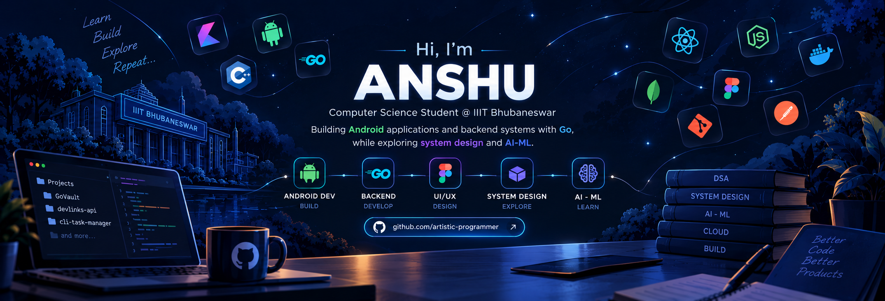

 <!-- Profile README for artistic-programmer -->

  

## Hey, I'm Anshu 👋

CS undergrad at **IIIT Bhubaneswar**, interested in how software works under the hood — from backend systems and APIs to the apps people use every day.

Most of my work revolves around **Go, Android development, and building for the web**. I've worked on projects ranging from **GoVault** and **DevLinks API** to **Financy** and the **TechSoc website** at my institute.

Currently exploring **System Design and AI/ML**, strengthening my fundamentals, and building projects along the way.

I like understanding the *why* behind the code, not just getting it to run.

  

---

## 🛠️ Tech Stack

| Category | Technologies |
|---|---|
| **Languages** |  |
| **Android** |   |
| **Backend** |  |
| **Web** |  |
| **AI/ML & Data Science** |      |
| **Databases** |  |
| **Tools & Design** |  |
---

## 🚀 Featured Projects

### 1. [DevLinks API](https://github.com/artistic-programmer/devlinks-api)

A backend API project focused on building and working with web services.

  
  

### 2. [GoVault](https://github.com/artistic-programmer/GoVault)

A Go-based project showcasing backend development and practical Go programming.

  
  

### 3. [TechSoc Website](https://github.com/artistic-programmer/techsoc-26)

The official website of TechSoc, the Technical Society of IIIT Bhubaneswar, featuring community initiatives, technical domains, events, team information, and contact pages.

  
  
  

### 4. [Financy — Calm Money Log](https://github.com/artistic-programmer/Financy)

A minimalist, private, offline-first Android expense tracker with transaction management and monthly financial analytics.

  
  
  

---

## 🌱 Currently Learning

- **AI/ML:** Building foundations with Python, NumPy, Pandas, Matplotlib, and Seaborn.
- **System Design:** Exploring architecture, scalability, and backend design principles.
- **Backend Engineering:** Strengthening my Go skills by building practical projects and APIs.

---

## 🤝 Connect With Me

  

  <i>Learning by building. Improving one project at a time.</i>

